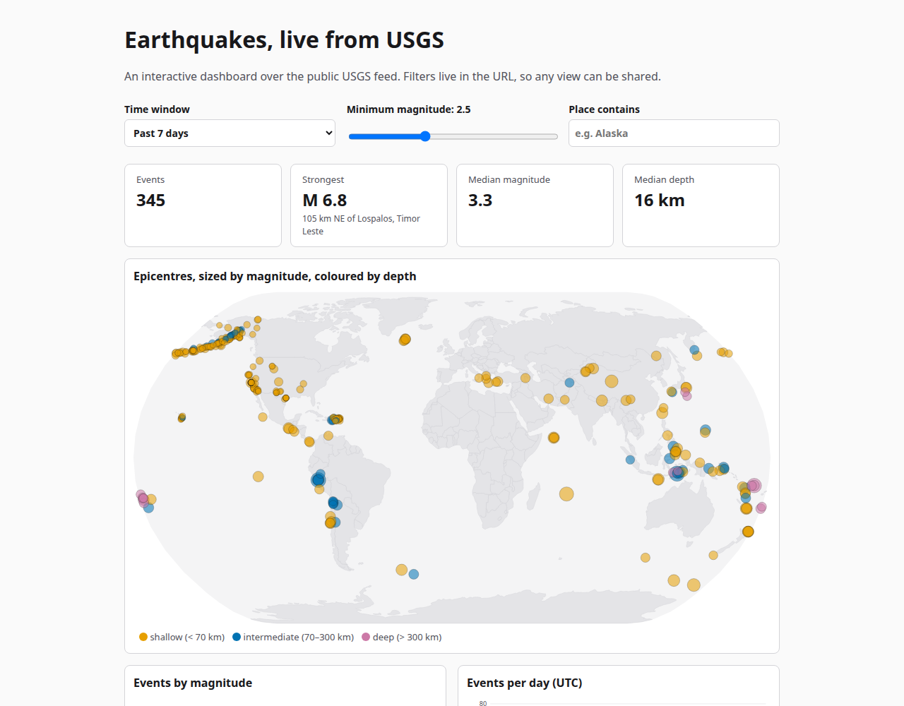

# Earthquake dashboard (React, TypeScript, D3)

[](https://github.com/codenlighten/data-dashboard/actions/workflows/ci.yml)

**[Open the live demo](https://codenlighten.github.io/data-dashboard/)** (GitHub Pages, published by this repository's CI after the tests pass; it reads the public USGS feed from your browser).



*The live demo on 2026-11-26. The data shown is from the USGS feed.*

An interactive dashboard over the public [USGS earthquake feed](https://earthquake.usgs.gov/earthquakes/feed/v1.0/geojson.php): summary tiles, a world map, two charts and a sortable table, with filters that live in the URL. It runs entirely in the browser; there is no server and no API key.

Shows front-end engineering with attention to data handling, accessibility and testing, not just a pretty chart.

## Run it

```bash
npm install
npm run dev        # http://localhost:5173
npm test           # unit and component tests
npx playwright install chromium   # once: downloads the browser the next command drives
npm run test:e2e   # Playwright, drives a real browser (the USGS feed is mocked)
```

Needs Node 22. On a bare Linux machine the browser may also need system libraries: `npx playwright install --with-deps chromium`.

## What this proves

- **Untrusted data is validated.** `src/data/parse.ts` checks every feature of the feed and drops and counts malformed ones, so one bad record cannot crash the page. Links are accepted only if they are `https:`. The UI tells the user how many features were skipped.
- **Pure, tested data layer.** Parsing, filtering, statistics (histogram, per-day counts with UTC zero-filling, medians) and URL state are plain functions in `src/data/`, tested against a trimmed copy of a real feed.
- **No stale-response bugs.** Switching the time window while a slow request is in flight cannot let the old answer replace the new one (`src/hooks/useQuakes.ts`). A test found a real bug here in my first version, where a late response left the page stuck on "Loading".
- **Shareable state.** Filters are read from and written to the URL, with hostile or invalid values falling back to defaults.
- **Accessible by construction.** Charts and the map are SVG with text labels (`role="img"`), and the same events are in a real `<table>` with sortable column buttons and `aria-sort`. Controls are labelled, focus is visible, the layout follows the system light or dark setting and reduced-motion preference, and the e2e suite checks a 360 px screen for horizontal scroll.
- **Light.** D3 is used only for scales, bins, shapes and map projection (`d3-array`, `d3-scale`, `d3-geo`); React renders the SVG. Production build: 389 kB JavaScript, 132 kB gzipped, including the world outline (Vite 8, one build, n=1).

## Tests

`npm test` runs 23 unit and component tests (Vitest and Testing Library). `npm run test:e2e` runs 5 Playwright tests in a real browser (installed Chrome, one browser only) against a built copy of the app, with the USGS request answered from a recorded sample so the tests are deterministic and offline.

### Deliberate breaks

I broke the code on purpose in six places and checked that a specific test failed each time, then restored it:

| Break | Test that caught it |
|---|---|
| Minimum magnitude made exclusive | `applyFilters` inclusive-boundary test |
| Unrated events sorted first | table sort test |
| Stale response allowed to replace the current one | stale-response test |
| `javascript:` links accepted | feed-validation test |
| Negative magnitude dropped from the histogram | histogram "loses no events" test |
| Page number not clamped when data shrinks | table paging test |

The browser test also caught an accessibility bug that unit tests had missed: the magnitude slider had no accessible name, because a wrapping `<label>` binds to the first labelable element inside it, which was the `<output>`, not the slider. It is fixed with an explicit `htmlFor`, and a unit test now fails on the old markup.

The first version of the stale-response test passed even with that break, because its fake `fetch` politely honoured the abort signal. Rewriting the test so the fake ignores the signal made it fail on my own code and exposed the "stuck on Loading" bug, which is now fixed.

## Limits

- Data is fetched by the visitor's browser straight from USGS. If USGS is down or blocks the request, the page shows an error and a retry button; there is no cache or fallback.
- Magnitudes for recent events are automatic and get revised. This is a visualisation, not a source for safety decisions.
- The map plots at most the 1,500 strongest events in the current view, to keep the SVG light.
- Colour encodes depth (colour-blind-safe palette), but depth is also in the table, so colour is never the only channel for the data.
- No real-time updates; the feed is fetched when the window changes or on retry.
- Not audited with a screen reader; only keyboard and automated checks were done. Browser tests ran in Chrome only.

## Data and licence

Earthquake data: USGS Earthquake Hazards Program (public domain). World outline: `world-atlas` (Natural Earth, public domain). Code: MIT, see `LICENSE`.
